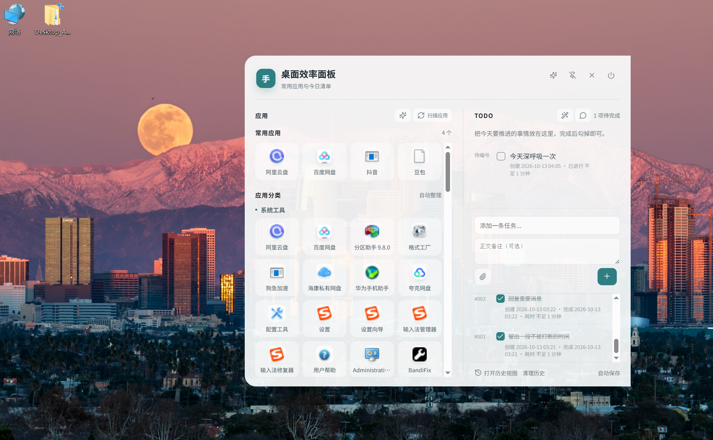

# desktodo

> Languages: [中文](#中文) | [English](#english) | [日本語](#日本語) | [한국어](#한국어)



## 中文

desktodo 是一个基于 AI 接口的 Windows 桌面快速启动工具。它把应用启动器、AI 应用整理和 Todo 任务面板放在一个简洁干净的桌面侧边栏里，适合希望快速打开常用软件、快速记录任务，并让 AI 辅助整理工作流的用户。

和传统启动器相比，desktodo 不只是列出应用。它可以扫描开始菜单和桌面快捷方式，通过 AI 根据应用名称、路径、发布者等信息自动整理分类；右侧同时提供 Todo List，可以快速创建、编辑、完成任务，并让 AI 帮你分析待办事项、规划今天可以执行的任务。

### 核心特点

- 桌面右侧常驻：默认收起为小图标，鼠标悬停即可展开。
- 快速应用启动：扫描 Windows 开始菜单和桌面快捷方式，点击即可启动应用。
- AI 应用整理：接入 OpenAI 兼容接口后，可自动分析应用用途并生成分类。
- Todo List：快速新增、编辑、完成、删除任务，本地持久化保存。
- AI 任务规划：基于当前 Todo，让 AI 帮你分析任务并生成可执行计划。
- 历史记录：已完成任务可进入历史窗口查看。
- 托盘控制：支持显示、隐藏、退出和开机启动开关。
- 简洁干净：没有复杂附属项，目标是做一个轻量、直接、可修改的桌面效率工具。

### 快速上手

1. 启动后把鼠标移动到桌面右侧小图标，面板会自动展开。
2. 左侧是应用区，点击应用卡片即可快速启动。
3. 点击“扫描应用”可以重新读取开始菜单和桌面快捷方式。
4. 点击 AI 设置，填入 `API Key`、`Base URL`、`Model` 后保存。
5. 配置好 AI 后，可以使用 AI 整理应用分类，也可以让 AI 根据 Todo 生成任务计划。
6. 右侧是 Todo List，输入任务后点击加号即可创建；完成后勾选，任务会进入历史记录。
7. 右上角和托盘菜单可以控制显示、隐藏、退出、开机启动等操作。

### 运行环境

- Windows 10/11
- Node.js 18 或更高版本
- npm
- Git
- 一个 OpenAI 兼容的 AI 接口，只有使用 AI 分类和任务分析时才需要

### 安装方式一：从源码运行

适合想先体验、二次开发或自己打包的用户。

```powershell
git clone git@github.com:ohmoneymoneygohome/desktodo.git
cd desktodo
npm install
npm start
```

启动后，应用会出现在桌面右侧。默认是收起状态，把鼠标移到右侧小图标附近即可展开。

如果你使用 HTTPS 克隆，也可以运行：

```powershell
git clone https://github.com/ohmoneymoneygohome/desktodo.git
cd desktodo
npm install
npm start
```

### 安装方式二：打包成本地 Windows 程序

仓库不会提交 `node_modules/`、`release/`、缓存目录和本地 Todo 数据。你需要在本机安装依赖后自行打包：

```powershell
npm install
npm run dist
```

打包完成后，启动文件在：

```text
release\win-unpacked\桌面效率面板.exe
```

这个目录是 Electron 的 Windows 解包目录版。运行时不要只复制 exe，最好保留整个 `release\win-unpacked` 文件夹，否则可能缺少 Electron 运行所需文件。

### 如何使用

1. 启动应用  
   运行 `npm start`，或运行打包后的 `release\win-unpacked\桌面效率面板.exe`。

2. 展开面板  
   应用默认贴在桌面右侧，鼠标悬停到右侧小图标区域即可展开。

3. 启动应用  
   面板会扫描 Windows 开始菜单和桌面快捷方式。找到应用后，点击即可启动。

4. 使用 AI 整理应用  
   先在 AI 设置里填入 `API Key`、`Base URL` 和 `Model`，然后使用 AI 分类功能。AI 会根据应用名称、路径、发布者等信息判断应用用途，并生成更自然的分类。

5. 创建 Todo  
   在右侧 Todo List 中直接输入任务。任务支持新增、编辑、完成、删除，并会保存到本机。

6. 让 AI 分析任务  
   配置 AI 接口后，可以让 AI 根据当前 Todo 生成当天可执行计划，帮助你把零散任务整理成更清楚的执行顺序。

7. 查看历史  
   已完成任务会进入历史记录窗口，方便回看已经处理过的事项。

8. 托盘操作  
   通过系统托盘菜单可以显示、隐藏、退出应用，也可以控制开机启动。

### AI 接口配置

应用支持 OpenAI 兼容接口。你可以在应用内填写：

- `API Key`
- `Base URL`
- `Model`

默认配置偏向 OpenAI API，也可以改成其他兼容服务商的接口地址。API Key 会通过 Electron 的 `safeStorage` 加密后保存到本机用户数据目录，不会提交到仓库。

示例：

```text
Base URL: https://api.openai.com/v1
Model: gpt-4o-mini
```

如果你使用第三方兼容接口，请以服务商提供的 Base URL 和模型名为准。

### 交给智能体安装的提示词

如果你使用 Codex、Cursor、Claude Code、GitHub Copilot Workspace 或其他 AI 编程智能体，可以直接把下面这段提示词交给它：

```text
请帮我在 Windows 上安装并运行这个项目：

仓库地址：git@github.com:ohmoneymoneygohome/desktodo.git

要求：
1. 检查本机是否有 Node.js、npm 和 Git。
2. 克隆仓库到一个合适的本地目录。
3. 进入项目目录后执行 npm install。
4. 执行 npm start 启动 Electron 应用。
5. 如果我要生成可执行版本，执行 npm run dist。
6. 告诉我打包后的启动文件位置：release\win-unpacked\桌面效率面板.exe。
7. 不要提交 node_modules、release、缓存目录或本地 Todo 数据。
8. 如果运行失败，请根据终端错误定位原因并修复。
```

如果智能体无法使用 SSH，可以把仓库地址换成 HTTPS：

```text
https://github.com/ohmoneymoneygohome/desktodo.git
```

### 常见问题

**找不到启动 exe？**  
当前打包脚本生成的是目录版，启动文件在 `release\win-unpacked\桌面效率面板.exe`。不要只看 `release` 根目录。

**为什么 GitHub 仓库里没有 exe？**  
构建产物体积较大，而且不同电脑环境可能需要重新打包，所以仓库默认只保存源码。需要 exe 时请本地运行 `npm run dist`。

**AI 功能不能用？**  
请先确认已经填写 API Key、Base URL 和 Model，并且接口服务商支持 OpenAI 兼容格式。

**应用数据保存在哪里？**  
Todo 历史、AI 配置和窗口位置等运行数据保存在 Electron 的用户数据目录，不会写入项目源码目录。

### 项目结构

```text
main.js                     Electron 主进程、窗口、托盘、应用扫描、AI 调用
preload.js                  渲染进程安全桥接
desktop-utility-panel.html  主界面
todo-history.html           Todo 历史窗口
build.js                    Windows 打包脚本
package.json                项目脚本和 Electron Builder 配置
```

### 欢迎修改优化

这个项目保持了比较直接的结构，方便继续改造。欢迎大家根据自己的桌面习惯优化交互、分类逻辑、任务规划方式、UI 细节、打包方式，或者接入更多 AI 服务。

---

## English

desktodo is an AI-powered Windows desktop launcher and Todo panel. It stays on the right side of your desktop, collapses into a small icon, and expands on hover so you can quickly launch apps, create tasks, and let AI help organize your workflow.

Unlike traditional launchers, desktodo can scan Start Menu and desktop shortcuts, then use an OpenAI-compatible API to classify applications by their purpose. It also includes a clean Todo List where you can quickly create, edit, complete, and review tasks. AI can analyze your current tasks and generate an actionable plan for the day.

### Requirements

- Windows 10/11
- Node.js 18 or later
- npm
- Git
- An OpenAI-compatible API, only required for AI classification and task planning

### Install and Run

```powershell
git clone https://github.com/ohmoneymoneygohome/desktodo.git
cd desktodo
npm install
npm start
```

The app will appear on the right side of the desktop. Hover near the small collapsed icon to expand it.

### Build for Windows

```powershell
npm install
npm run dist
```

Output:

```text
release\win-unpacked\桌面效率面板.exe
```

Keep the whole `release\win-unpacked` folder when running the packaged app. The exe depends on the other Electron runtime files in that folder.

### Usage

1. Start the app with `npm start` or the packaged exe.
2. Hover over the right-side collapsed icon to expand the panel.
3. Launch Windows apps scanned from Start Menu and desktop shortcuts.
4. Configure `API Key`, `Base URL`, and `Model` to enable AI app classification.
5. Create, edit, complete, and delete Todo items locally.
6. Ask AI to analyze your Todo list and generate a practical daily plan.
7. Use the tray menu to show, hide, quit, or enable startup.

### Prompt for AI Coding Agents

You can paste this prompt into Codex, Cursor, Claude Code, GitHub Copilot Workspace, or another coding agent:

```text
Install and run this Windows Electron project:

Repository: https://github.com/ohmoneymoneygohome/desktodo.git

Tasks:
1. Check that Node.js, npm, and Git are installed.
2. Clone the repository.
3. Run npm install in the project directory.
4. Run npm start to launch the Electron app.
5. If I need a packaged Windows build, run npm run dist.
6. Tell me that the packaged exe is release\win-unpacked\桌面效率面板.exe.
7. Do not commit node_modules, release, cache directories, or local Todo data.
8. If anything fails, inspect the terminal error and fix the cause.
```

Contributions and custom modifications are welcome.

---

## 日本語

desktodo は、AI インターフェースを利用した Windows 向けのデスクトップ高速ランチャー兼 Todo パネルです。画面右側に常駐し、通常は小さなアイコンとして折りたたまれ、マウスを近づけると展開してアプリ起動やタスク管理をすばやく行えます。

従来のランチャーと違い、desktodo はスタートメニューやデスクトップのショートカットをスキャンし、OpenAI 互換 API を使ってアプリを自動分類できます。右側の Todo List ではタスクを素早く作成でき、AI にタスクの分析や実行計画の作成を任せることもできます。

### インストール

```powershell
git clone https://github.com/ohmoneymoneygohome/desktodo.git
cd desktodo
npm install
npm start
```

Windows 版を生成する場合：

```powershell
npm run dist
```

出力先：

```text
release\win-unpacked\桌面效率面板.exe
```

### 主な機能

- 右側に常駐する折りたたみ式デスクトップパネル。
- Windows アプリの高速起動。
- AI によるアプリ分類。
- Todo の作成、編集、完了、削除、ローカル保存。
- AI によるタスク分析と計画作成。
- 完了済みタスクの履歴表示。
- トレイメニューによる表示、非表示、終了、スタートアップ設定。
- 余計な機能を入れないシンプルな設計。

---

## 한국어

desktodo는 AI 인터페이스를 기반으로 한 Windows 데스크톱 빠른 실행 도구이자 Todo 패널입니다. 화면 오른쪽에 작은 아이콘으로 접혀 있다가 마우스를 올리면 펼쳐져 앱 실행, 작업 생성, AI 기반 작업 분석을 빠르게 사용할 수 있습니다.

일반적인 런처와 달리 desktodo는 시작 메뉴와 바탕화면 바로가기를 스캔하고, OpenAI 호환 API를 통해 앱의 용도를 분석해 자동으로 분류할 수 있습니다. 오른쪽 Todo List에서는 작업을 빠르게 만들고 수정하며, AI가 현재 작업을 분석해 실행 계획을 제안할 수 있습니다.

### 설치

```powershell
git clone https://github.com/ohmoneymoneygohome/desktodo.git
cd desktodo
npm install
npm start
```

Windows 빌드를 만들려면:

```powershell
npm run dist
```

출력 위치:

```text
release\win-unpacked\桌面效率面板.exe
```

### 주요 기능

- 오른쪽에 고정되는 접이식 데스크톱 패널.
- Windows 앱 빠른 실행.
- AI 기반 앱 분류.
- Todo 생성, 편집, 완료, 삭제 및 로컬 저장.
- AI 기반 작업 분석과 실행 계획 생성.
- 완료된 작업 기록 보기.
- 트레이 메뉴를 통한 표시, 숨김, 종료, 시작 프로그램 설정.
- 불필요한 부가 기능을 줄인 깔끔한 구조.
